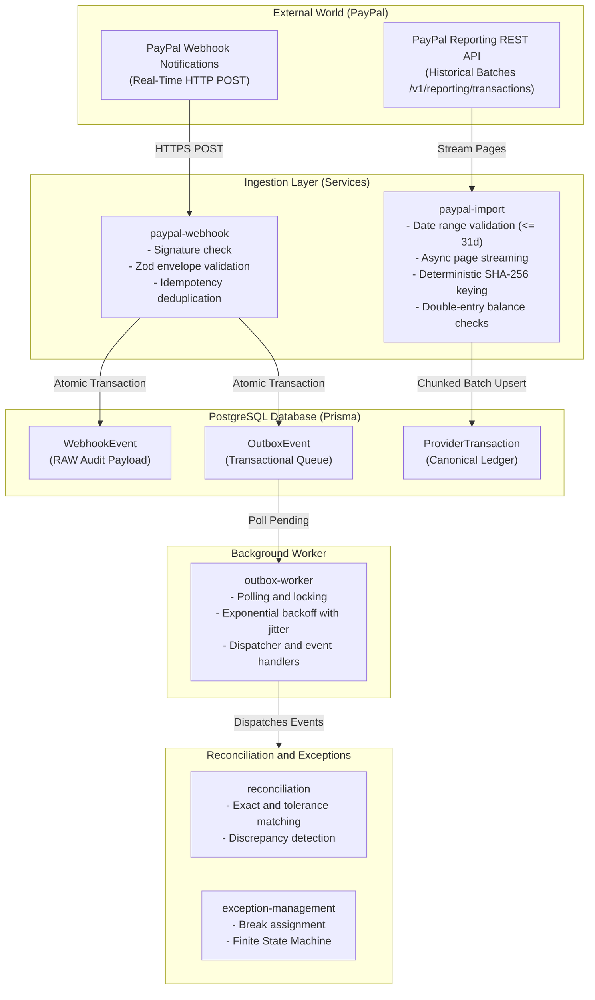
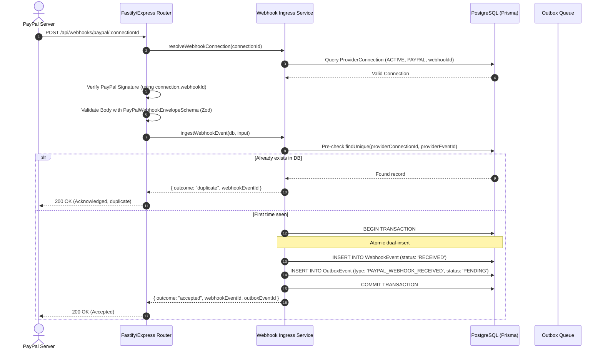
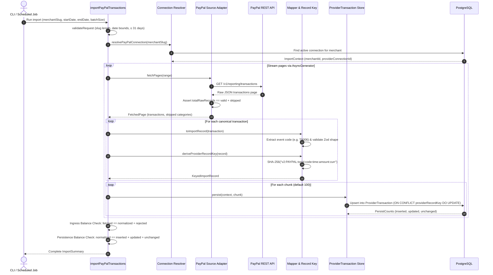
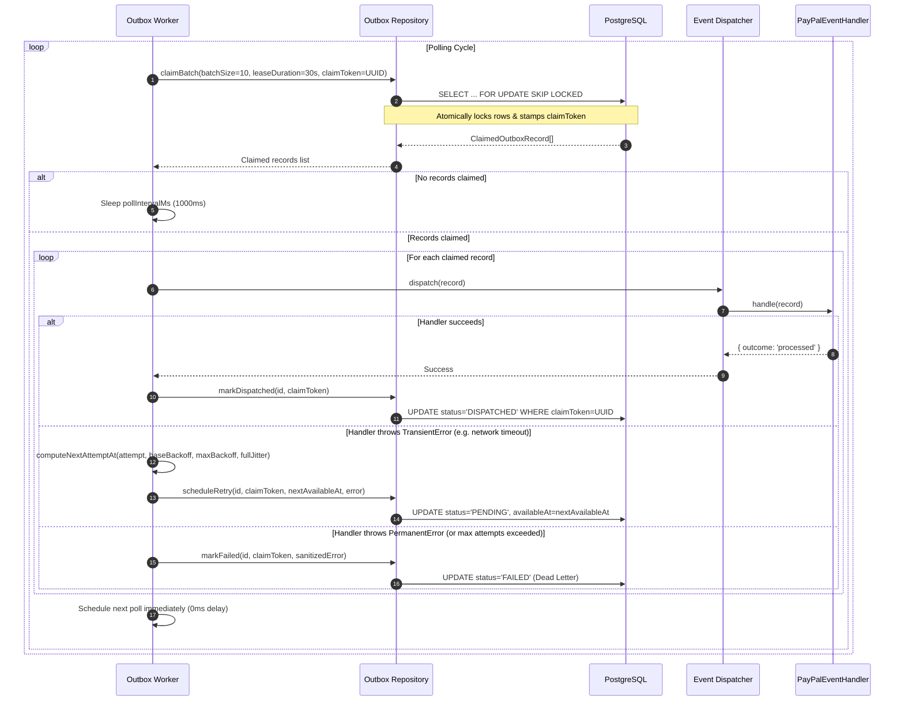
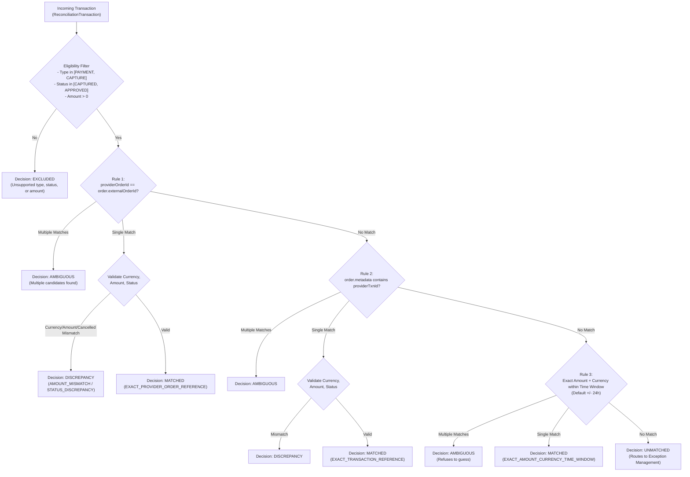
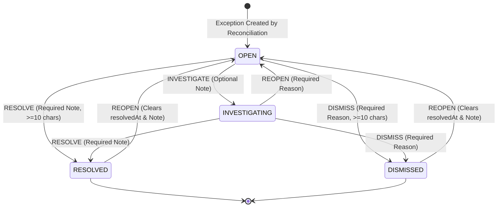

# ReconResolve — Backend Services Architecture & Engineering Guide

This document provides a comprehensive technical breakdown of the services within `backend/src/services`. It covers the end-to-end data flow, system architecture, file-by-file walkthroughs, edge cases, and design invariants.

---

## 1. High-Level System Architecture

ReconResolve orchestrates transaction reconciliation between external payment providers (starting with PayPal) and internal merchant records.



---

## 2. End-to-End Data Flows

### A. Real-Time Webhook Data Flow (`paypal-webhook`)



---

### B. Batch / Historical Import Data Flow (`paypal-import`)



---

## 3. Deep Dive: `backend/src/services/paypal-webhook`

> **Plain English Overview:**
> This service acts as the digital front door for real-time notifications sent by PayPal whenever a payment is captured, denied, or refunded. It checks that the webhook actually came from PayPal, validates that the data is well-formed, and filters out duplicates. To prevent losing any event if the server crashes, it atomically saves both the raw payload and an outbox queue task into PostgreSQL in a single database transaction.
>
> * **Input:** Incoming HTTP POST request containing PayPal webhook headers (signature, transmission ID) and the raw JSON event envelope.
> * **Output:** An HTTP 200 acknowledgement with an ingestion outcome (`accepted` or `duplicate`), a persisted `WebhookEvent` audit record, and an associated `OutboxEvent` task ready for processing.

### Purpose
Provides a resilient, replay-safe ingress pipeline for real-time webhooks emitted by PayPal.

### File Walkthrough

#### 1. [`envelope-schema.ts`](file:///c:/projects/ReconResolve/backend/src/services/paypal-webhook/envelope-schema.ts)
* **What it does:** Validates the outer envelope of incoming PayPal webhook JSON payloads using Zod.
* **Key mechanics:**
  * Requires `id` (PayPal's unique event ID, e.g. `WH-8JH...`) and `event_type` (e.g. `PAYMENT.CAPTURE.COMPLETED`).
  * Uses `.passthrough()` so unmodeled fields sent by future PayPal API versions are not stripped.
  * Exports inferred TypeScript type `PayPalWebhookEnvelope`.

#### 2. [`types.ts`](file:///c:/projects/ReconResolve/backend/src/services/paypal-webhook/types.ts)
* **What it does:** Defines data transfer interfaces for webhook ingress.
* **Key contracts:**
  * `ResolvedWebhookConnection`: Encapsulates tenant ID (`merchantId`), `webhookId`, and connection status.
  * `IngestWebhookInput`: Carries connection info, provider event ID, event type, transmission headers, and raw payload.
  * `IngestOutcome`: Union of `'accepted' | 'duplicate'`.

#### 3. [`webhook-ingress.service.ts`](file:///c:/projects/ReconResolve/backend/src/services/paypal-webhook/webhook-ingress.service.ts)
* **What it does:** Houses the connection verification and atomic storage logic.
* **Key functions:**
  * `resolveWebhookConnection(db, providerConnectionId)`:
    * Validates that `providerConnectionId` is a valid UUID format via regex.
    * Verifies that the record exists, `provider === 'PAYPAL'`, `status === 'ACTIVE'`, and `webhookId` is configured.
  * `isWebhookEventConflict(error)`:
    * Inspects Prisma error codes for unique constraint violation (`P2002`) targeting the compound index `providerConnectionId_providerEventId`.
  * `ingestWebhookEvent(db, input)`:
    * **Step 1 (Pre-check):** Reads `webhookEvent.findUnique`. If already present, skips work and returns `{ outcome: 'duplicate' }`.
    * **Step 2 (Atomic Transaction):** Runs `$transaction` creating both the `WebhookEvent` record (raw payload audit) and the `OutboxEvent` (`eventType: 'PAYPAL_WEBHOOK_RECEIVED'`).
    * **Step 3 (Race Recovery):** If two identical requests hit concurrently and bypass the pre-check, catching the `P2002` constraint violation allows the service to gracefully return `{ outcome: 'duplicate' }` without throwing a 500 error.

---

## 4. Deep Dive: `backend/src/services/paypal-import`

> **Plain English Overview:**
> This service pulls historical transaction records directly from PayPal's Reporting API for a chosen date range (up to 31 days). It handles pagination automatically, translates PayPal's complex data formats into our clean internal transaction format, and generates a unique fingerprint (SHA-256 hash) for every event to prevent duplicate entries. Finally, it double-checks that the number of fetched rows matches the number of saved rows before reporting success.
>
> * **Input:** Merchant identifier (`merchantSlug`), a date range (`startDate`, `endDate`, up to 31 days), and optional batch chunk size.
> * **Output:** Standardized `ProviderTransaction` records saved in the database, along with an `ImportSummary` detailing how many rows were fetched, inserted, updated, and rejected.

### Purpose
Provides scheduled and manual historical transaction synchronization against PayPal's Reporting API (`/v1/reporting/transactions`).

### File Walkthrough

#### 1. [`types.ts`](file:///c:/projects/ReconResolve/backend/src/services/paypal-import/types.ts)
* **`ImportRecord`:** Core normalized staging structure.
  * Amounts are stored as **`bigint` minor units** (e.g., `$12.50` is stored as `1250n` cents) to prevent floating-point rounding errors.
* **`KeyedImportRecord`:** An `ImportRecord` bundled with its derived `providerRecordKey`.
* **`TransactionSource`:** Streaming pagination abstraction using `AsyncIterable<FetchedPage>` so imports scale to arbitrarily large date windows without out-of-memory crashes.
* **`ImportSummary`:** Return payload tracking `fetched`, `normalized`, `inserted`, `updated`, `unchanged`, and `rejected` counts with failure categorization.

#### 2. [`errors.ts`](file:///c:/projects/ReconResolve/backend/src/services/paypal-import/errors.ts)
* Defines typed error codes: `PAYPAL_SYNC_INVALID_ARGS`, `PAYPAL_SYNC_MERCHANT_NOT_FOUND`, `PAYPAL_SYNC_CONNECTION_NOT_FOUND`, `PAYPAL_SYNC_CONNECTION_AMBIGUOUS`, `PAYPAL_SYNC_SOURCE_INCONSISTENT`, `PAYPAL_RECORD_KEY_INVALID`, `PAYPAL_SYNC_PERSISTENCE_FAILED`, etc.
* **Security & Log Sanitization:** `ImportError` defines `originalError` with `enumerable: false`. When JSON loggers serialize errors, database credentials, internal connection strings, or query plans embedded in low-level driver errors are kept out of production logs.

#### 3. [`record-key.ts`](file:///c:/projects/ReconResolve/backend/src/services/paypal-import/record-key.ts)
* **What it does:** Generates a deterministic, collision-resistant hash identifying a unique transaction event:
  $$\text{Record Key} = \text{"v2:"} + \text{SHA256}([\text{"v2"}, \text{"PAYPAL"}, \text{txnId}, \text{eventCode}, \text{occurredAt}, \text{amountMinor}, \text{currency}])$$
* **Why this is critical:** PayPal often updates a transaction ID multiple times over its lifecycle (e.g. authorization $\rightarrow$ capture $\rightarrow$ fee $\rightarrow$ refund). Incorporating `eventCode` and `amountMinor` guarantees distinct lifecycle events produce distinct record keys while identical sync reruns generate the exact same key.

#### 4. [`connection-resolver.ts`](file:///c:/projects/ReconResolve/backend/src/services/paypal-import/connection-resolver.ts)
* Resolves a merchant slug (e.g. `--merchant-slug default-merchant`) to an active database tenant.
* **Ambiguity Protection:** Executes `findMany({ where: { merchantId, provider: 'PAYPAL', status: 'ACTIVE' }, take: 2 })`. If `connections.length > 1`, throws `PAYPAL_SYNC_CONNECTION_AMBIGUOUS`. The system explicitly refuses to guess which connection to synchronize when multiple exist.

#### 5. [`paypal-source.ts`](file:///c:/projects/ReconResolve/backend/src/services/paypal-import/paypal-source.ts)
* Bridges the low-level PayPal API adapter with the import coordinator.
* **Strict Double-Check Accounting:**
  ```typescript
  if (result.totalRawRecords !== result.transactions.length + rejected) {
      throw new ImportError('PAYPAL_SYNC_SOURCE_INCONSISTENT', ...);
  }
  ```
  If PayPal reports 100 rows, but the parser yields 92 valid records and 6 skipped records, **2 records disappeared**. Rather than silently losing data, the import immediately halts.
* Categorizes skipped items into actionable buckets (`invalid_amount_or_currency`, `unsupported_status_or_event`, `missing_required_field`).

#### 6. [`mapper.ts`](file:///c:/projects/ReconResolve/backend/src/services/paypal-import/mapper.ts)
* Maps canonical transactions into `ImportRecord` shapes.
* Traverses nested payload structures (`rawPayload.transaction_info.transaction_event_code`) to extract the PayPal 5-character event code (e.g. `T0006` for sale, `T1107` for refund).
* Runs Zod validation against allowed statuses (`CREATED`, `CAPTURED`, `REFUNDED`, etc.) and transaction types (`PAYMENT`, `CAPTURE`, `REFUND`, etc.).
* Throws granular `UnsupportedRecordError('invalid_field:amountMinor')` allowing the coordinator to log the exact invalid field for operators.

#### 7. [`import-paypal-transactions.ts`](file:///c:/projects/ReconResolve/backend/src/services/paypal-import/import-paypal-transactions.ts)
* **Master Coordinator Workflow:**
  1. **Validation (`validateRequest`):** Ensures merchant slug is valid, dates parse correctly, `from < to`, and date window does not exceed PayPal's reporting API limit of **31 days** (`toMs - fromMs > MAX_RANGE_MS`).
  2. **Page Streaming:** Iterates through `source.fetchPages(range)` asynchronously.
  3. **Mapping & Keying:** Generates the deterministic `providerRecordKey` for each row.
  4. **Chunked Database Persistence:** Batches records into configurable chunks (default 100, max 1,000) using a generator function `*chunk(items, size)`.
  5. **Final Balancing Audit (Double Invariant Check):**
     * **Ingress Balance:** `summary.fetched === summary.normalized + summary.rejected`
     * **Persistence Balance:** `summary.normalized === summary.inserted + summary.updated + summary.unchanged`

---

## 5. Deep Dive: `backend/src/services/outbox`

> **Plain English Overview:**
> This service is a background worker daemon that continuously processes queued tasks without slowing down web requests or dropping events. It safely locks pending events in PostgreSQL using unique lease tokens so multiple servers don't process the same event twice. If a temporary network glitch or database timeout happens, it retries automatically using exponential backoff with randomized delay; if an unfixable error occurs, it marks the event as permanently failed and cleans any sensitive secrets from the error message.
>
> * **Input:** Pending `OutboxEvent` rows stored in the database.
> * **Output:** Executed domain tasks (e.g., updating webhook processing statuses) and updated outbox row statuses (`DISPATCHED`, `PENDING` retry with next timestamp, or `FAILED`).

### Purpose
Implements the **Transactional Outbox Pattern** with distributed lease-locking and at-least-once delivery guarantees. It ensures that asynchronous tasks and domain events produced by webhooks or imports are reliably processed without blocking HTTP endpoints or risking lost operations.



### File Walkthrough

#### 1. [`types.ts`](file:///c:/projects/ReconResolve/backend/src/services/outbox/types.ts)
* **`OutboxRecord`:** Represents the outbox database model with tracking fields (`attemptCount`, `claimToken`, `lockedAt`, `availableAt`, `status`).
* **`ClaimedOutboxRecord`:** Type-narrowed contract guaranteeing that `claimToken` is a non-null `string`.
* **`OutboxRepository`:** Port defining atomic batch claiming (`claimBatch`), completion (`markDispatched`), retrying (`scheduleRetry`), and terminal failure (`markFailed`).

#### 2. [`backoff.ts`](file:///c:/projects/ReconResolve/backend/src/services/outbox/backoff.ts)
* Computes retry delays with **Full Jitter**:
  $$\text{delay} = \text{random}(0, \min(\text{maxDelay}, \text{baseDelay} \times 2^{\text{attempt}-1}))$$
* Exponential caps prevent integer overflow at exponent $\le 30$.
* Jitter evenly distributes retries across the time horizon, preventing Thundering Herd stampedes when external dependencies recover.

#### 3. [`error-sanitizer.ts`](file:///c:/projects/ReconResolve/backend/src/services/outbox/error-sanitizer.ts)
* **Transient vs. Permanent Classification (`isTransientError`):**
  * Transient errors (Prisma connection pool exhaustion `P1001`, query timeouts `P1002`, transaction deadlock `P2034`, socket drops `ECONNRESET`) are scheduled for exponential retry.
  * Permanent errors (`PermanentError`, invalid JSON schemas, missing entity references) bypass retries and fail immediately.
* **Redaction Engine (`sanitizeErrorMessage`):**
  * Strips bearer tokens (`Bearer [REDACTED]`), PostgreSQL connection URIs with credentials (`postgresql://[REDACTED]`), and secrets before persisting to database error fields.

#### 4. [`outbox-logger.ts`](file:///c:/projects/ReconResolve/backend/src/services/outbox/outbox-logger.ts)
* Produces structured JSON logs containing `workerId`, `event`, `outboxId`, `attempt`, `durationMs`, and `outcome`.

#### 5. [`event-dispatcher.ts`](file:///c:/projects/ReconResolve/backend/src/services/outbox/event-dispatcher.ts)
* Registry mapping `aggregateType` (e.g. `'WebhookEvent'`) to dedicated domain handlers. Throws `PermanentError` if an event has no registered handler.

#### 6. [`handlers/paypal-event-handler.ts`](file:///c:/projects/ReconResolve/backend/src/services/outbox/handlers/paypal-event-handler.ts)
* Evaluates inbound PayPal webhook records.
* Matches against `SUPPORTED_PAYPAL_EVENTS` (`PAYMENT.CAPTURE.COMPLETED`, `PAYMENT.CAPTURE.DENIED`, `PAYMENT.CAPTURE.REFUNDED`, `CHECKOUT.ORDER.APPROVED`).
* Unrecognized events are marked `PROCESSED` with `{ outcome: 'ignored' }`, ensuring the outbox does not retry unneeded event types indefinitely.

#### 7. [`outbox-worker.ts`](file:///c:/projects/ReconResolve/backend/src/services/outbox/outbox-worker.ts)
* **Autonomous Polling Daemon:**
  * Runs non-overlapping poll cycles via `pollOnce()`.
  * Claims batches using unique lease tokens (`claimToken`).
  * Enforces **claim-token fencing**: If a worker takes too long to process a record and its lease expires, `markDispatched` checks `claimToken`. If another worker took the lease, the update returns `false` and the stale worker drops the result safely.
  * **Adaptive Polling:** If records were claimed, next poll runs immediately (`0ms` delay); if idle, sleeps for `pollIntervalMs`.
  * **Graceful Draining:** On SIGTERM/shutdown, rejects new work and awaits in-flight promises up to `drainTimeoutMs`.

---

## 6. Deep Dive: `backend/src/services/reconciliation`

> **Plain English Overview:**
> This service is the automated matching engine that compares money collected in PayPal against internal customer orders placed on your store. It uses a 3-step matching strategy: first looking for an exact order reference ID, second checking for an exact payment transaction ID, and third looking for the exact amount and currency placed within a 24-hour time window. If two orders have the exact same amount in that window, it refuses to guess and flags it for human review.
>
> * **Input:** A merchant ID, payment connection ID, time window (`from`, `to`), and an `idempotencyKey`.
> * **Output:** A `ReconciliationRun` audit summary reporting totals, matched order-payment pairs (`ReconciliationMatch`), and flagged discrepancies or missing transactions routed to Exception Management.

### Purpose
The matching engine of ReconResolve. Evaluates external payment provider transactions against internal merchant orders using a prioritized, multi-tier matching policy hierarchy.



### File Walkthrough

#### 1. [`types.ts`](file:///c:/projects/ReconResolve/backend/src/services/reconciliation/types.ts)
* **`MatchDecision` Discriminated Union:**
  * `'matched'`: Matched to a single order with verifiable audit evidence.
  * `'unmatched'`: No order found in candidate window; flags an unmatched transaction exception.
  * `'ambiguous'`: Multiple candidates found; refuses to guess and flags for human operator review.
  * `'discrepancy'`: Found candidate order, but detected an `AMOUNT_MISMATCH` or `STATUS_DISCREPANCY` (e.g. order was cancelled).
  * `'excluded'`: Non-payment or non-settled transaction (refunds, adjustments, zero-amount authorizations).
* **`ReconciliationRepository`:** Port for creating runs, fetching eligible records, candidate search, and batch persistence.

#### 2. [`errors.ts`](file:///c:/projects/ReconResolve/backend/src/services/reconciliation/errors.ts)
* Typed error codes: `RECON_INVALID_INPUT`, `RECON_MERCHANT_NOT_FOUND`, `RECON_CONNECTION_NOT_FOUND`, `RECON_PERSISTENCE_FAILED`.
* Non-enumerable `originalError` property protects database drivers from leaking into logs.

#### 3. [`matching-policy.ts`](file:///c:/projects/ReconResolve/backend/src/services/reconciliation/matching-policy.ts)
* **Pure Evaluation Hierarchy (`evaluateMatch`):**
  1. **Eligibility Filter:** Rejects transaction types other than `PAYMENT` / `CAPTURE`, statuses other than `CAPTURED` / `APPROVED`, and non-positive amounts.
  2. **Rule 1 (Exact Provider Order ID):** Checks `order.externalOrderId` or metadata order references. Validates currency, minor units amount, and asserts order is not `CANCELLED`.
  3. **Rule 2 (Exact Transaction Reference):** Checks order metadata for stored transaction IDs (`providerTxnId`, `paypalTransactionId`).
  4. **Rule 3 (Exact Amount + Currency within Tolerance Window):**
     * Checks $|T_{\text{txn}} - T_{\text{order}}| \le \text{toleranceMs}$ (default 24h).
     * If multiple candidates match amount and time window, it returns `ambiguous` rather than guessing.
  5. **Fallback:** Returns `unmatched` with `reasonCode: 'NO_CANDIDATE_ORDERS'`.

#### 4. [`reconciliation.service.ts`](file:///c:/projects/ReconResolve/backend/src/services/reconciliation/reconciliation.service.ts)
* **Reconciliation Run Coordinator (`run`):**
  1. Validates UUIDs, input date ranges (`from < to`), and batch sizes (1 to 200).
  2. Enforces multi-tenant ownership (`connection.merchantId === input.merchantId`).
  3. Implements **Idempotency via `idempotencyKey`**: Re-invoking with the same key returns the completed run summary without re-executing.
  4. Paginates through un-reconciled transactions, evaluates candidate matches, and atomically persists match links and exceptions per batch via `persistBatchOutcomes`.
  5. Finalizes run status as `COMPLETED` or `FAILED` with execution telemetry (`durationMs`, `totalConsidered`, `matchedCount`, `unmatchedCount`).

---

## 7. Deep Dive: `backend/src/services/exception-management`

> **Plain English Overview:**
> This service manages the lifecycle of financial breaks and discrepancies (such as payments with no matching order, price mismatches, or charges on cancelled orders). It enforces a strict Finite State Machine where exceptions must move logically between `OPEN`, `INVESTIGATING`, `RESOLVED`, and `DISMISSED`. Every status change requires an explanation note (minimum 10 characters), records an immutable audit history of who did what, and uses version numbers to stop two operators from overwriting each other's changes.
>
> * **Input:** Operator actions (`RESOLVE`, `REOPEN`, `DISMISS`, `INVESTIGATE`) with explanation notes, target `exceptionId`, and `expectedVersion`.
> * **Output:** Updated exception state (`status`, `resolutionNote`, `resolvedAt`, incremented `version`) and an immutable `ExceptionAuditEvent` record.

### Purpose
Manages the lifecycle of reconciliation discrepancies ("Exceptions" or "Breaks"). Ensures that every break is investigated, resolved, or dismissed according to a strict **Finite State Machine**, protected by **Optimistic Concurrency Control (OCC)**, and backed by an immutable audit trail.



### File Walkthrough

#### 1. [`types.ts`](file:///c:/projects/ReconResolve/backend/src/services/exception-management/types.ts)
* **`ExceptionStatus`:** `'OPEN' | 'INVESTIGATING' | 'RESOLVED' | 'DISMISSED'`
* **`ExceptionType`:**
  * `MISSING_PROVIDER_COUNTERPART`: Order present in merchant ledger but no provider charge exists.
  * `MISSING_MERCHANT_COUNTERPART`: Provider charged customer but no merchant order exists.
  * `AMOUNT_MISMATCH`: Identifiers matched, but minor unit amounts differ.
  * `STATUS_DISCREPANCY`: Order cancelled, but provider payment was captured.
  * `AMBIGUOUS_MATCH`: Multiple candidate orders fit the same criteria.
* **`OperatorContext`:** Tracks `actorId`, `actorType` (`OPERATOR`, `SYSTEM`, `ADMIN`), `roles`, `authorizedMerchantIds`, and `correlationId`.
* **Input Envelopes:** `ResolveExceptionInput`, `ReopenExceptionInput`, `DismissExceptionInput`, and `InvestigateExceptionInput` all require `expectedVersion: number`.

#### 2. [`errors.ts`](file:///c:/projects/ReconResolve/backend/src/services/exception-management/errors.ts)
* Strongly typed operational error classes with mapped HTTP status codes:
  * `FORBIDDEN_TENANT_ACCESS` (403): Read-only viewers attempting modifications.
  * `UNAUTHORIZED_OPERATOR` (401): Missing actor identity.
  * `EXCEPTION_NOT_FOUND` (404): Exception not found, or access denied (anti-enumeration).
  * `INVALID_STATE_TRANSITION` (409): Attempting an illegal FSM status leap.
  * `CONCURRENCY_CONFLICT` (409): Optimistic concurrency collision (`expectedVersion` mismatch).
  * `VALIDATION_FAILED` (400): Missing or insufficient note length.

#### 3. [`state-machine.ts`](file:///c:/projects/ReconResolve/backend/src/services/exception-management/state-machine.ts)
* **`ALLOWED_TRANSITIONS` Matrix:**
  * Enforces valid paths: `OPEN/INVESTIGATING -> RESOLVED/DISMISSED`, `RESOLVED/DISMISSED/INVESTIGATING -> OPEN`.
  * Direct transitions between `RESOLVED <-> DISMISSED` are disallowed without first reopening to `OPEN`.
* **Note Validation (`sanitizeNote`):**
  * Requires meaningful text between **10 and 1,000 characters**.
* **Transition Planner (`validateAndPlanTransition`):**
  * Computes the exact `fromStatus`, `toStatus`, `resolvedAt`, and `resolutionNote` updates.
  * Reopening an exception automatically resets `resolvedAt` and `resolutionNote` to `null`.

#### 4. [`exception-lifecycle.service.ts`](file:///c:/projects/ReconResolve/backend/src/services/exception-management/exception-lifecycle.service.ts)
* **High-Level Service Operations:**
  * `listExceptions(...)`: Cursor-based paginated search with filters for status, run, transaction, and order IDs.
  * `getException(...)`: Loads comprehensive details including linked provider transaction, merchant order, reconciliation run, and full chronological audit events.
  * `resolve(...)`, `reopen(...)`, `dismiss(...)`, `investigate(...)`.
* **Security & Reliability Guarantees:**
  * **Anti-Enumeration Guard (`assertMerchantAccess`):** Returns 404 rather than 403 for unauthorized tenants to prevent tenant existence discovery.
  * **Permission Guard (`assertMutationPermission`):** Blocks read-only `VIEWER` roles.
  * **Atomic OCC Mutation:** Executes `applyAtomicTransition` checking `version === expectedVersion`. If two operators modify the same break concurrently, the second gets a clean 409 conflict error.
  * **Audit Event Persistence:** Creates an immutable `ExceptionAuditEvent` record inside the same database transaction.

---

## 8. Summary of Service Interactions

| Service | Primary Trigger | Key Pattern / Invariant | Core Output Table |
|---|---|---|---|
| **`paypal-webhook`** | HTTP Webhooks from PayPal | Idempotent deduplication + Dual-write Transactional Outbox | `WebhookEvent`, `OutboxEvent` |
| **`paypal-import`** | CLI / Scheduled Ingestion | Streaming pagination + Deterministic SHA-256 Keying (`v2:<hash>`) | `ProviderTransaction` |
| **`outbox`** | Background Worker Loop | Distributed lease locking (`claimToken`) + Full Jitter Backoff | Updates `OutboxEvent` & `WebhookEvent` |
| **`reconciliation`** | User / Scheduled Job | Multi-tier evaluation hierarchy + Zero-guess ambiguity defense | `ReconciliationRun`, `ReconciliationMatch` |
| **`exception-management`** | Human Operator / API | Strict Finite State Machine + Optimistic Concurrency Control (OCC) | `Exception`, `ExceptionAuditEvent` |
| **`ai-investigator`** | Human Operator / API (`POST .../investigate`) | Grounded citation integrity + strict read-only advisory + live Gemini provider | `ExceptionInvestigation` |

---

## 9. AI Investigation & Model Provider Architecture

The AI Investigator service provides automated root-cause analysis and non-destructive remediation advice for payment reconciliation exceptions.

### Architecture & Trust Boundary
* **Advisory & Read-Only Invariant:** AI investigations never modify exception status, dispute status, order state, or transaction amounts.
* **Evidence Grounding:** All citations returned by the model (`likelyCauses`, `facts`, `recommendedActions`) must strictly exist in the server-assembled `availableEvidenceRefs`. Hallucinated references trigger runtime validation errors (`AIInvestigatorError.unknownEvidenceReference`).
* **Tenant Isolation:** Prompts are constructed strictly within the authenticated tenant scope. Untrusted text is shielded with `<untrusted_external_content>` XML fences.
* **Database Persistence:** Investigations are immutably persisted to PostgreSQL (`exception_investigations`).

### Model Provider Configuration (Google Gemini)
The production adapter uses the official `@google/genai` SDK.
* **Configuration:**
  ```bash
  GEMINI_API_KEY="your-gemini-api-key"
  GEMINI_MODEL_ID="gemini-2.5-flash"  # Optional, defaults to gemini-2.5-flash
  ```
* **Failure Modes:**
  * **Production (`NODE_ENV=production`):** Missing credentials fails closed with `503 PROVIDER_UNAVAILABLE`. Production never silently selects the test fake provider.
  * **Automated Tests (`NODE_ENV=test`):** Uses deterministic `TestFakeInvestigationModelProvider` by default. Zero external network calls or paid credits consumed.
  * **Opt-in Live Smoke Test:** Gated behind `LIVE_AI_TEST=true` and `GEMINI_API_KEY`.
    ```bash
    LIVE_AI_TEST=true GEMINI_API_KEY="your-key" npm test test/services/ai-investigator/gemini-live-smoke.integration.test.ts
    ```


